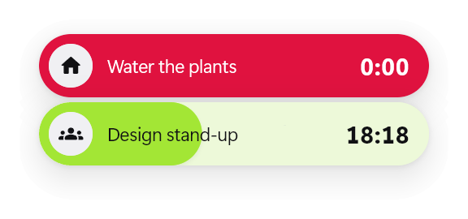
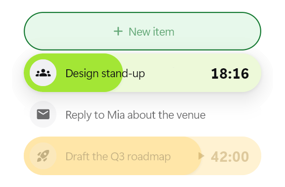
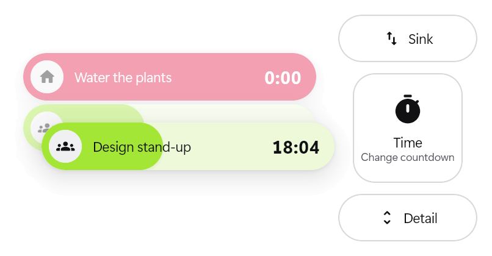
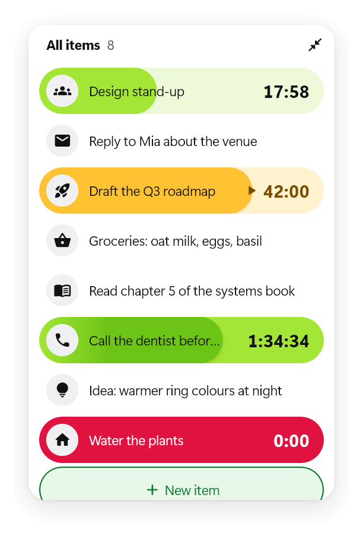
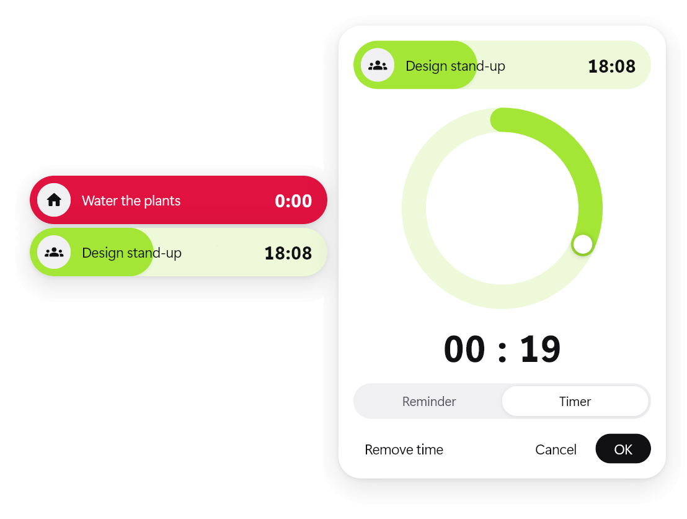
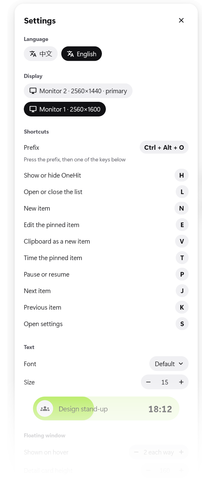

<p align="center">
  
</p>

<h1 align="center">OneHit</h1>

<p align="center">
  An always-on-top floating strip for Windows that keeps the one piece of
  information you need next in view.
</p>

<p align="center">
  <b>English</b> · <a href="README.zh-CN.md">中文</a>
</p>

<p align="center">
  
  
</p>

Information and tasks are the same thing here: an item is a line of text, an
icon, and tags. A countdown is drawn as an Activity-style ring unrolled into
the item's pill: lime while running, amber while paused, solid red when it
ends.

## Download

Get `OneHit-<version>-windows-x64.zip` from
[Releases](https://github.com/BetulaSuk/OneHit-reborn/releases), unzip it
anywhere, and run `onehit.exe`. Windows 10 or 11, 64-bit. Keep the files
together: the exe needs the DLLs and the `data` folder next to it.

## Features

Everything in [`docs/top-idea.md`](docs/top-idea.md) is built.

| Where | What you do | What happens |
| --- | --- | --- |
| Strip | Hover | Neighbouring items fade in above and below; the strip stays put. Near the top or bottom of the screen the rows go to the side with room, and at the bottom the list runs upward |
| Strip | Wheel / left click / middle click | Scroll / pin an item / return to the pinned one |
| Strip | Click the time | Pause or resume the countdown |
| Strip | Right click an item | Edit its text in place (Enter saves, Shift+Enter new line, Esc cancels; an emptied item is deleted) |
| Strip | Click the add slot | Creates an item and opens it for editing |
| Strip | Drag | Moves the window; the position is saved |
| Strip | Double click | Opens the list (at most half the screen high) |
| List | Middle click | Scrolls back to the top |
| List | Double click the header | Shrinks back to the strip (so does Esc or the corner button) |
| List | Double click or right click an item | Opens the side editor beside its row: text, icon palette, tags, delete. It follows the row and closes for good once the row scrolls out of view |
| Strip or list | Long press and drag an item | The window dims and tag zones appear around it; drop on one to apply it |
| Tag: Sink / Float | Drop | Sinks the item to the bottom (dimmed, timer paused), or floats it back |
| Tag: Time | Drop | Opens the ring dial: drag the knob, scroll the ring (±5 min), hours (±1 h) or minutes (±1 min); one lap per hour, up to 12 h; Reminder or Timer |
| Tag: Detail | Drop | The pinned strip grows a detail card with the full text (raised to fit when the strip is near the bottom, as is the inline editor) |
| Any item | Drop an image file or image URL on it | It becomes the item's icon (centre-cropped to 128 px) |
| Any item | Drop or paste text | Appended to the item's text (with nothing selected, a paste creates a new item) |
| Window | Paste an image (Ctrl+V) | Replaces the selected item's icon |

Timers run only while their item is pinned; Reminders always run; sunk items
pause. An ended Reminder that is not pinned stays above the strip.

<p align="center">
  
</p>
<p align="center">
  
  
</p>

The OS window covers the chosen display's work area, but only the drawn
surfaces take the mouse (a native click region), so the rest of the desktop
stays usable.

### Tray icon

OneHit sits in the notification area (Windows may first put it in the hidden
icons behind `^`).

- **Left click:** shows the strip and gives it the keyboard.
- **Right click:** Settings…, About OneHit (version, the prefix, the data
  folder), Hide / Show OneHit, Quit.

### Shortcuts

Press the prefix, `Ctrl+Alt+O` by default, then one key within 3 seconds. A
panel beside the strip lists the keys while it waits. The key after the
prefix is taken by OneHit, so it never types into the app that has focus.

| Key | Action |
| --- | --- |
| `H` | Hide or show OneHit |
| `L` | Open or close the list |
| `N` | New item, open for editing |
| `E` | Edit the pinned item |
| `V` | Clipboard text or image as a new item |
| `T` | Time dial for the pinned item |
| `P` | Pause or resume the pinned item's countdown |
| `J` / `K` | Next / previous item |
| `S` | Settings |

If another app already holds the prefix, the settings panel says so in red;
record a different one there.

### Settings



Open them from the tray menu or with the prefix then `S`. Changes apply at
once and are saved.

- **Language:** 中文 or English. Until you pick one, OneHit follows the
  Windows display language.
- **Display:** which display OneHit shows on. The strip keeps its relative
  spot.
- **Shortcuts:** record a new prefix (it needs Ctrl, Alt, Shift or Win),
  and change the key for each action. Taking a key another action uses
  swaps them.
- **Text:** the font (any installed family, searchable) and size (12–20),
  with a live preview.
- **Floating window:** rows shown each way on hover, the detail card's
  height, and start with Windows.

<br clear="right">

### Data and config

Saved under `%APPDATA%\dev.onehit\onehit\`:

- `items.json`: the items, including icons and countdown state.
- `state.json`: the strip's last position.
- `config.json`: what the settings panel writes. Editing it by hand works
  too; restart OneHit afterwards.

| Key | Default | Meaning |
| --- | --- | --- |
| `previewRadius` | `2` | Items shown above and below the strip on hover (0–6) |
| `detailHeight` | `160` | Height of the detail card (60–600) |
| `prefix` | `"ctrl+alt+o"` | One or more of `ctrl` / `alt` / `shift` / `win`, then a key name |
| `keys` | see above | Action → key name, for `toggle`, `list`, `create`, `edit`, `paste`, `time`, `pause`, `next`, `previous`, `settings` |
| `display` | `""` | Windows display name such as `\\.\DISPLAY1`; empty or missing means the primary display |
| `fontFamily` | `""` | Font family; empty means Segoe UI Variable Display |
| `fontSize` | `15` | Item text size (12–20); the time is a third larger |
| `language` | `""` | `"zh"` or `"en"`; empty follows the Windows display language |

Key names are `a`–`z`, `0`–`9`, `f1`–`f12`, `space`, `enter`, `tab`,
`backspace`, `insert`, `delete`, `home`, `end`, `pageup`, `pagedown`, `left`,
`up`, `right`, `down`, and `` ` - = [ ] \ ; ' , . / ``. Bad values fall back to
the defaults. Delete the data files to see the first-run tips again (they are
written in the language in effect).

### Plugins

A plugin implements `OneHitPlugin` (`lib/plugin.dart`) and is added to the
`plugins` list in `lib/main.dart`. It can contribute `TagZone`s, which appear
next to the built-in tags during a drag and get the store and the dropped
item in `onDrop`. It can also watch the `ItemStore` in `attach`. A plugin
keeps its own per-item data in `InfoItem.extra`, which is saved with the item.

## Build from source

Requires Flutter 3.47+ with Windows desktop support.

```bash
flutter pub get
```

```bash
flutter run -d windows
```

```bash
flutter test
```

```bash
flutter build windows --release
```

The release build lands in `build\windows\x64\runner\Release\`.

## Layout

```
lib/
  main.dart                     startup: load data, place the window on the chosen display, plugins
  config.dart                   config.json options, shortcut actions, ConfigStore
  strings.dart                  every piece of UI text, in Chinese and English
  plugin.dart                   OneHitPlugin, TagZone, built-in tags
  theme/tokens.dart             design tokens: geometry, state colours, type, motion
  theme/controls.dart           panel surface and controls shared by the editor and settings
  item/                         the item component, independent of the windows
    info_item.dart              InfoItem and TimeTag (countdown derived from the wall clock)
    item_store.dart             item list, 1 Hz tick, Timer/Reminder rules, edits
    storage.dart                JSON files in the app support folder
    info_item_view.dart         the pill: icon disc, text, time cell, LapPainter
    item_cards.dart             detail card, inline editor, add slot
    item_gestures.dart          click / double click / right click / long press / move
    icon_image.dart             image file, URL or clipboard → 128 px icon
  shell/                        the screen-sized window that hosts everything
    shell.dart                  state: mini/list, selection, tag drag, dial, panels, drops, paste, tray, shortcuts
    regions.dart                HitRegion widgets → native click region
    native.dart                 bridge to the runner: click region, drops, tray, prefix, displays, fonts, autostart
    keys.dart                   key names, virtual-key codes, prefix chords
    prefix_hint.dart            the key list shown after the prefix
  settings/settings_panel.dart  the settings panel
  settings/about_panel.dart     the about panel and app mark
  mini_window/mini_window.dart  the strip: hover preview, scroll, pin, inline edit
  list_window/list_window.dart  the list and its side-editor layer
  editor/side_editor.dart       the side editor
  tags/tag_layer.dart           tag zones and the dragged item
  tags/time_dial.dart           the ring dial
windows/runner/native_bridge.*  click region, OLE drop target, tray icon, prefix hotkey and keyboard hook,
                                display placement and DPI, font list, start with Windows
test/                           countdown rules, JSON, store, config, key bindings, zone layout, editor keys
docs/assets/                    the icon and the README screenshots (en/, zh/)
```

## Docs

- [`docs/top-idea.md`](docs/top-idea.md): the original product concept (Chinese).
- [`PRODUCT.md`](PRODUCT.md): users, purpose, constraints, open questions, principles.
- [`DESIGN.md`](DESIGN.md): the design system ("The Unrolled Ring"): colours, type,
  layout, components, and rules. Its machine-readable sidecar is
  [`.impeccable/design.json`](.impeccable/design.json).
