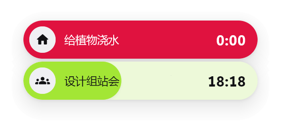
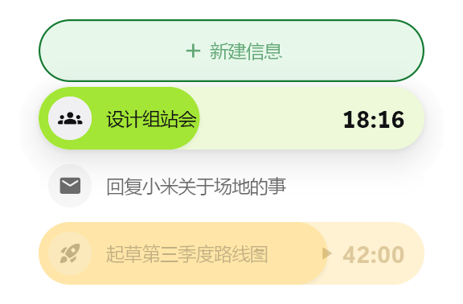
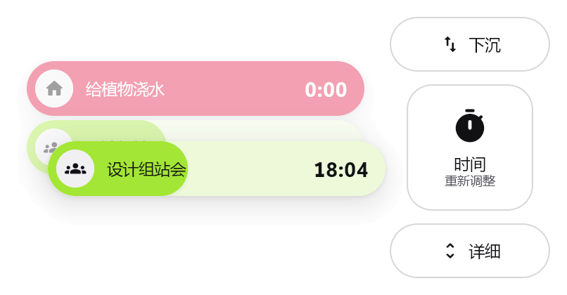
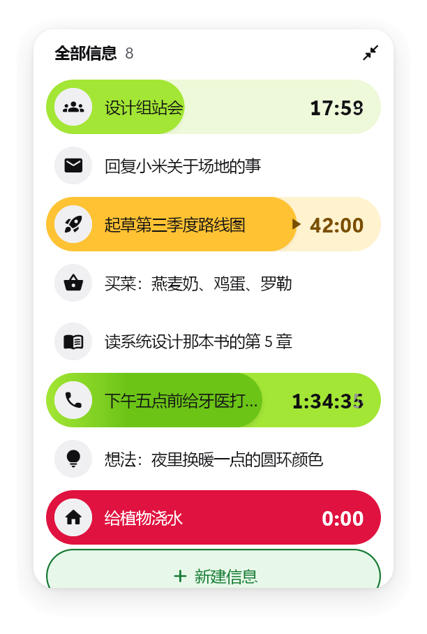
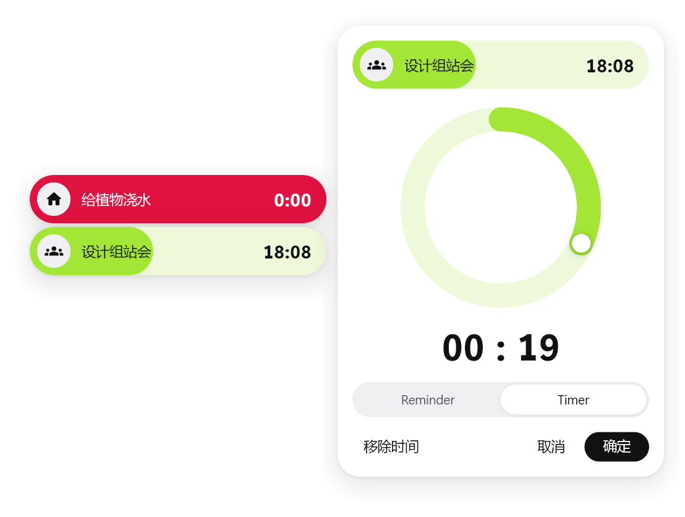

<p align="center">
  
</p>

<h1 align="center">OneHit</h1>

<p align="center">
  一键唤起的轻量信息缓存区：Windows 上始终置顶的浮窗，把你接下来要用的那条信息留在眼前。
</p>

<p align="center">
  <a href="README.md">English</a> · <b>中文</b>
</p>

<p align="center">
  
  
</p>

在这里，信息和任务是同一种东西：一条信息就是一行文字、一个图标和若干标签。倒计时画成一圈
展开在信息胶囊里的“健身圆环”：计时中是青柠绿，暂停是琥珀黄，结束后整条变红。

## 下载

从 [Releases](https://github.com/BetulaSuk/OneHit-reborn/releases) 下载
`OneHit-<版本>-windows-x64.zip`，解压到任意位置，运行 `onehit.exe`。需要 64 位
Windows 10 或 11。请保持文件在一起：exe 需要旁边的 DLL 和 `data` 文件夹。

## 功能

[`docs/top-idea.md`](docs/top-idea.md) 里的设想已全部实现。

| 位置 | 操作 | 效果 |
| --- | --- | --- |
| 浮窗 | 悬停 | 上下渐显相邻的信息，浮窗本身不动。靠近屏幕上下边缘时，行会排到有空间的一侧；在底部时列表向上展开 |
| 浮窗 | 滚轮 / 左键 / 中键 | 翻看 / 置顶一条信息 / 回到置顶的那条 |
| 浮窗 | 点击时间 | 暂停或继续倒计时 |
| 浮窗 | 右键一条信息 | 就地编辑文字（Enter 保存，Shift+Enter 换行，Esc 取消；清空即删除） |
| 浮窗 | 点击新建栏 | 新建一条信息并进入编辑 |
| 浮窗 | 拖动 | 移动浮窗，位置会保存 |
| 浮窗 | 双击 | 打开列表（最高半屏） |
| 列表 | 中键 | 回到顶部 |
| 列表 | 双击标题栏 | 缩回浮窗（Esc 或角上的按钮也可以） |
| 列表 | 双击或右键一条信息 | 在该行旁打开侧边编辑器：文字、图标、标签、删除。它跟随该行，该行滚出视野后关闭 |
| 浮窗或列表 | 长按并拖动信息 | 窗口变暗，周围出现标签区，拖到上面即添加标签 |
| 标签：下沉 / 上浮 | 放下 | 把信息沉到底部（变淡，计时暂停），或浮回来 |
| 标签：时间 | 放下 | 打开圆环表盘：拖动旋钮，或在圆环（±5 分钟）、小时（±1 小时）、分钟（±1 分钟）上滚动；一圈一小时，最多 12 小时；可选 Reminder 或 Timer |
| 标签：详细 | 放下 | 置顶的浮窗下方展开详细卡片，显示全文（靠近底部时整体上移以完整显示，就地编辑也一样） |
| 任意信息 | 拖入图片文件或图片链接 | 设为该信息的图标（居中裁成 128 px） |
| 任意信息 | 拖入或粘贴文字 | 追加到信息文字后面（未选中信息时粘贴会新建一条） |
| 窗口 | 粘贴图片（Ctrl+V） | 替换选中信息的图标 |

Timer 只在该信息置顶时计时；Reminder 一直计时；下沉的信息暂停。未置顶的已结束 Reminder
会停在浮窗上方。

<p align="center">
  
</p>
<p align="center">
  
  
</p>

系统窗口覆盖所选显示屏的工作区，但只有画出来的部分接收鼠标（原生点击区域），桌面其余部分照常可用。

### 托盘图标

OneHit 在通知区域里（Windows 可能先把它收在 `^` 后面的隐藏图标中）。

- **左键：** 显示浮窗并让它接收键盘。
- **右键：** 设置…、关于 OneHit（版本、前缀键、数据文件夹）、隐藏浮窗 / 显示浮窗、退出。

### 快捷键

先按前缀键（默认 `Ctrl+Alt+O`），再在 3 秒内按一个键。等待期间浮窗旁会列出可用的键。
前缀键之后的那个键由 OneHit 接管，不会输入到当前程序里。

| 键 | 作用 |
| --- | --- |
| `H` | 显示或隐藏 OneHit |
| `L` | 打开或关闭列表 |
| `N` | 新建信息并进入编辑 |
| `E` | 编辑置顶的信息 |
| `V` | 把剪贴板里的文字或图片存为新信息 |
| `T` | 给置顶的信息打开时间表盘 |
| `P` | 暂停或继续置顶信息的倒计时 |
| `J` / `K` | 下一条 / 上一条信息 |
| `S` | 设置 |

如果前缀键已被其他程序占用，设置面板会用红字提示，在那里录一个新的即可。

### 设置


从托盘菜单打开，或按前缀键再按 `S`。改动即时生效并保存。

- **语言：** 中文或 English。没选之前跟随 Windows 显示语言。
- **显示屏：** OneHit 显示在哪块屏幕上，浮窗保持相对位置。
- **快捷键：** 录制新的前缀键（需要带 Ctrl、Alt、Shift 或 Win），以及修改每个动作的键。
  选了别的动作正在用的键时，两者互换。
- **文字：** 字体（任意已安装字体，可搜索）和字号（12–20），带实时预览。
- **浮窗：** 悬停时前后各显示几条、详细卡片的高度、开机时启动。

<br clear="right">

### 数据与配置

保存在 `%APPDATA%\dev.onehit\onehit\`：

- `items.json`：所有信息，包括图标和倒计时状态。
- `state.json`：浮窗上次的位置。
- `config.json`：设置面板写入的内容。也可以手动编辑，改完重启 OneHit。

| 键 | 默认值 | 含义 |
| --- | --- | --- |
| `previewRadius` | `2` | 悬停时浮窗上下各显示几条（0–6） |
| `detailHeight` | `160` | 详细卡片的高度（60–600） |
| `prefix` | `"ctrl+alt+o"` | `ctrl` / `alt` / `shift` / `win` 中的一个或多个，加一个键名 |
| `keys` | 见上表 | 动作 → 键名，动作有 `toggle`、`list`、`create`、`edit`、`paste`、`time`、`pause`、`next`、`previous`、`settings` |
| `display` | `""` | Windows 显示器名，如 `\\.\DISPLAY1`；为空或缺失表示主屏 |
| `fontFamily` | `""` | 字体名；为空表示 Segoe UI Variable Display |
| `fontSize` | `15` | 信息文字字号（12–20）；时间大三分之一 |
| `language` | `""` | `"zh"` 或 `"en"`；为空跟随 Windows 显示语言 |

键名包括 `a`–`z`、`0`–`9`、`f1`–`f12`、`space`、`enter`、`tab`、`backspace`、
`insert`、`delete`、`home`、`end`、`pageup`、`pagedown`、`left`、`up`、`right`、
`down`，以及 `` ` - = [ ] \ ; ' , . / ``。无效的值会回退到默认值。删除数据文件即可再次看到
首次运行的提示（按当时的语言写入）。

### 插件

插件实现 `OneHitPlugin`（`lib/plugin.dart`），并加入 `lib/main.dart` 里的 `plugins` 列表。
它可以提供 `TagZone`，拖动时和内置标签一起出现，在 `onDrop` 中拿到 store 和被拖入的信息；
也可以在 `attach` 中监听 `ItemStore`。插件把自己的每条数据存在 `InfoItem.extra` 里，随信息一起保存。

## 从源码构建

需要 Flutter 3.47+ 及 Windows 桌面支持。

```bash
flutter pub get
```

```bash
flutter run -d windows
```

```bash
flutter test
```

```bash
flutter build windows --release
```

发布版在 `build\windows\x64\runner\Release\`。

## 目录结构

代码结构见 [英文 README 的 Layout 一节](README.md#layout)。界面文字集中在
`lib/strings.dart`，中英文并排。

## 文档

- [`docs/top-idea.md`](docs/top-idea.md)：最初的产品设想。
- [`PRODUCT.md`](PRODUCT.md)：用户、目的、约束、待定问题和原则（英文）。
- [`DESIGN.md`](DESIGN.md)：设计系统“The Unrolled Ring”：颜色、字体、布局、组件和规则（英文）。
  机器可读版本是 [`.impeccable/design.json`](.impeccable/design.json)。
